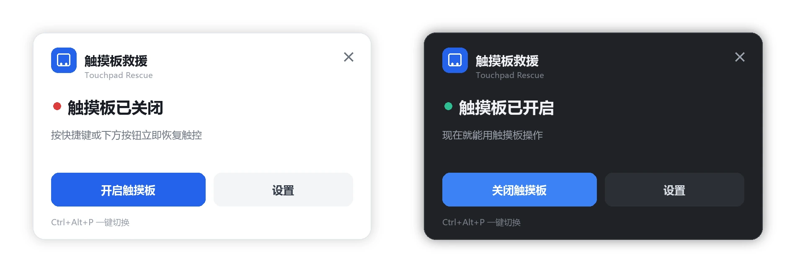

# 触摸板救援 TouchpadRescue

给小米 RedmiBook 14 Pro 2026（Windows 11 23H2，触摸板为 Goodix GXTP7863 标准 HID 精密触摸板）写的小工具。

解决的问题只有一个：**触摸板在系统设置里被关掉、手边又没有鼠标时，能用键盘把触摸板救回来。**



> 版本 v1.0.1 · Windows 10 1809+ / Windows 11 · 需要管理员权限

写这个工具的完整过程在博客上：**[红米笔记本触摸板快捷键：REDMI Book Pro 14 2026 没有，我用 Ctrl+Alt+P 补了一个](https://xiaozou123.cn/redmibook-touchpad-shortcut/)** —
为什么改注册表没用、设备节点怎么重载、踩了哪些坑，都在那里。

---

## 0. 为什么值得做

这个死循环很真实：

1. 你在系统设置里把触摸板关了（用外接鼠标时不少人这么干）
2. 出门忘带鼠标
3. 想打开触摸板 → 需要鼠标去点开关 → 没有鼠标
4. 用键盘走设置面板？Tab 键要按十几次，Tab 焦点走到哪还看不清

绝大多数教程告诉你改注册表就行。**在这台机器上实测无效**——原因写在[第 3 节](#3-为什么不能只改注册表)。

---

## 1. 快速开始

| 步骤 | 操作 | 预期结果 |
|---|---|---|
| 1 | 双击 `dist\TouchpadRescue.exe` | 弹出 UAC，点"是" |
| 2 | 屏幕中央出现面板，托盘区出现蓝色图标 | 面板显示当前触摸板状态 |
| 3 | 按 `Ctrl + Alt + P` | 面板弹出并切换触摸板开关 |

首次以管理员身份运行后，程序会自己在任务计划里注册一个叫 `TouchpadRescue` 的启动项，之后开机会自动常驻，不再需要手动启动。

---

## 2. 使用说明

### 全局快捷键

默认 `Ctrl + Alt + P`。在设置里可以改成任意组合（必须带至少一个修饰键）。

快捷键被别的软件占用时，程序会自动退到 `Ctrl+Alt+Shift+P`、`Ctrl+Alt+F10`，并在面板上提示。

### 面板

| 元素 | 行为 |
|---|---|
| 主按钮 | 开 / 关触摸板，约 0.5 秒生效 |
| 设置 | 打开设置页 |
| 右上角 × | 关闭面板（面板也会在 3.5 秒后自动收起） |
| 卡片空白处按住拖动 | 移动面板位置，位置会记住 |
| `Esc` | 关闭面板 |

### 托盘图标

- **左键单击**：显示 / 收起面板
- **右键**：菜单（开/关触摸板、显示面板、设置、开机自启、退出）
- 图标蓝色 = 触摸板已开启，灰色带斜杠 = 已关闭

### 设置项

| 项目 | 说明 |
|---|---|
| 外观主题 | 跟随系统 / 浅色 / 深色，切换立即生效 |
| 全局快捷键 | 点"修改"后直接按新的组合键 |
| 开机自启 | 开关任务计划里的守护任务 |
| 底部信息 | 当前权限、识别到的触摸板、自启任务状态 |

---

## 3. 为什么不能只改注册表

这是本工具最核心的一点，也是绝大多数同类脚本失效的原因。

Windows 的触摸板开关，本质上只是把偏好写进：

```
HKCU\Software\Microsoft\Windows\CurrentVersion\PrecisionTouchPad\Status\Enabled
```

**但 HID 触摸板驱动不会实时读这个键。** 实测：把它从 0 改成 1，再广播 `WM_SETTINGCHANGE`，触摸板纹丝不动。

驱动只在**设备初始化时**读一次。所以必须让设备重新加载：

```
CM_Locate_DevNode  →  CM_Disable_DevNode  →  等待 0.45s  →  CM_Enable_DevNode
```

本工具走的正是这条路，实测每次切换约 **455 毫秒**。

代价是必须要有管理员权限（禁用/启用设备节点需要），所以 exe 内嵌了 `requireAdministrator` 清单。

设计上有一条硬性保证：**禁用之后无论发生什么（包括异常），`finally` 里都会把设备重新启用**。程序下次启动时还会对所有触摸板设备做一次幂等的启用自检，修正上次异常退出可能留下的"设备被禁用"状态。

---

## 4. 可靠性设计

对着你提的四条要求：

| 要求 | 落点 |
|---|---|
| 轻量化 | 单文件 exe 16 MB；常驻内存约 25–35 MB；无第三方运行时依赖（Pillow 已打包进 exe） |
| 开机自启 + 高优先级 | 任务计划，`RunLevel=HighestAvailable`，登录后延迟 8 秒启动，绕开 UAC 弹窗 |
| SLA / 不依赖过多组件 | 只用 Win32 API（user32 / gdi32 / setupapi / hid / cfgmgr32），不装任何驱动、不改系统文件 |
| 误关 / 被误杀后能回来 | 任务计划每 30 分钟触发一次；程序检测到已有实例会立即静默退出（<100ms），所以这个"轮询"几乎没有开销 |
| 界面关闭 | 点 × 或 Esc 只隐藏面板，**不会退出程序**；退出只能走托盘菜单 |

补充的几点：

- **单实例**：`Local\TouchpadRescue-SingleInstance` 互斥量，重复启动直接退出。
- **崩溃留痕**：窗口模式没有控制台，未捕获异常会写到 `%LOCALAPPDATA%\TouchpadRescue\crash.log`。
- **热键被占**：自动降级，并在面板提示。
- **非管理员运行**：不会瞎写注册表（写了也不生效，还会造成"显示已关闭、实际能用"的假状态），直接提示需要提权。

---

## 5. 验收清单

装完照着走一遍：

1. [ ] 双击 exe，UAC 点"是"，托盘出现蓝色图标
2. [ ] 按 `Ctrl+Alt+P`，面板弹出，状态在"已开启/已关闭"之间切换
3. [ ] 触摸板能正常划动（关掉之后应该完全没反应，再开回来恢复）
4. [ ] 面板上点 × 能关掉，程序**没有退出**（托盘图标还在）
5. [ ] 按 `Esc` 也能关面板
6. [ ] 按住卡片空白处能拖动面板
7. [ ] 打开设置，切深色/浅色，界面立刻变
8. [ ] 任务计划里能看到 `TouchpadRescue` 任务
9. [ ] 重启电脑，不碰任何东西，托盘图标自动出现
10. [ ] 任务管理器里结束 TouchpadRescue.exe，等到下一个 30 分钟周期（或手动运行一次任务），它会自己回来

---

## 6. 排查清单

**按了快捷键没反应**

- 托盘图标在不在？不在说明程序没起（看任务管理器）
- 别的地方是否占用了 `Ctrl+Alt+P`？到设置里换一个
- 面板上如果显示"未提权，功能受限"，说明这次是以普通权限启动的

**面板显示已开启，但触摸板还是不能用**

- 到「设备管理器 → 人体学输入设备」，看"符合 HID 标准的触摸板"是否被禁用。被禁用就右键启用
- 程序启动时会自动做一次启用自检，正常情况不需要手动处理

**开机后托盘图标没出现**

- 打开 `taskschd.msc`，找 `TouchpadRescue` 任务，看"上次运行结果"
- 常见原因：任务被安全软件拦了。把 exe 加进白名单后，在设置里重开一次"开机自启"

**设置里显示"自启任务未注册"**

- 说明 `schtasks` 没执行成功。以管理员身份重新打开程序，再切一次"开机自启"开关

**切换时听到设备插拔提示音**

- 正常现象。设备重载就是先移除再挂载。

---

## 7. 卸载

```powershell
# 1. 结束进程
Stop-Process -Name TouchpadRescue -Force

# 2. 删除自启任务（需要管理员）
schtasks /Delete /TN TouchpadRescue /F

# 3. 删配置和日志
Remove-Item "$env:APPDATA\TouchpadRescue" -Recurse -Force
Remove-Item "$env:LOCALAPPDATA\TouchpadRescue" -Recurse -Force
```

触摸板开关状态不受影响，会保持你最后设置的那个值。

---

## 8. 源码结构

```
src/
  tp_core.py     触摸板控制引擎：注册表读写、HID 设备枚举、设备重载、自检
  tp_win.py      Win32 层：分层窗口、托盘、全局热键、消息循环
  tp_ui.py       视觉层：Pillow 渲染面板与设置页、主题、托盘图标
  tp_config.py   配置读写、系统主题探测、任务计划的创建与删除
  tp_app.py      应用主体：单实例、后台线程、消息分发、菜单
build.bat        打包脚本
```

没有用 tkinter（本机 Python 不带），也没有用 PyQt——界面是 Pillow 画成 RGBA 位图，再用 `UpdateLayeredWindow` 贴上去。好处是圆角、阴影、逐像素透明都能精确控制，且不引入 GUI 框架。

重新打包：

```bat
cd src
python -m PyInstaller --onefile --windowed --uac-admin ^
  --name TouchpadRescue --icon ..\assets\app.ico ^
  --distpath ..\dist --workpath ..\build --specpath ..\build tp_app.py
```

---

## 9. 版本记录

| 版本 | 变更 |
|---|---|
| v1.0.1 | 修掉拖动面板时的剧烈抖动：改用屏幕绝对坐标算位移，拖动只走 `SetWindowPos` 不再重传位图，拖动期间不再响应 hover 重绘 |
| v1.0.0 | 首个可用版本 |
